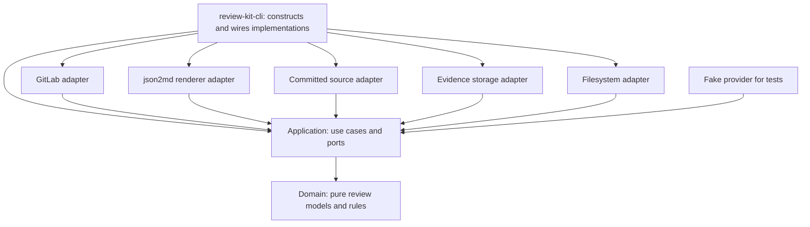

# Core and provider architecture

Status: the domain, application, infrastructure adapters and CLI implement this
architecture. The [implementation status](plan.md#current-status) records verification
boundaries.
The [domain README](../crates/lib/domain/README.md) and [application README](../crates/lib/application/README.md) define the current Rust contracts.

## Goal and boundary

Turn one accepted assessment into a review whose published effects can be checked and resumed.
The agent supplies judgment and evidence.
The library validates the assessment, compares it with current provider state, plans effects, and verifies publication.
The CLI selects infrastructure implementations and supplies trusted configuration and credentials.
The [review-run decision](decisions.md#review-runs-and-checkpoints) keeps each review's capture, draft and accepted assessment in ordinary files of a run.
The application carries unresolved publication intent in caller-owned progress; the CLI stores it in a journal bound to one run.
The [CLI guide](../crates/bin/cli/README.md#runtime-files) defines runtime
files and their references.

The design implements the GitLab publication scope in the [decisions](decisions.md).
The [review workflow](workflow.md) defines agent responsibilities and command boundaries.

## Components

The application, adapters and CLI share [operation observation](../crates/lib/observation/README.md).
Explicit boundaries provide disclosure projections to one synchronous lifecycle owner. The host supplies the JSON writer.
The domain remains independent of observation. Publication evidence retains its separate authority over write admission.
[Generated boundaries](../crates/lib/observation/README.md#generated-operation-boundaries) make observation implicit at declared workflow, internal stage, adapter and CLI operations.
Public application ingress binds raw ports to managed facades; internal composition retains those handles.

The arrows show source dependencies, not the order of provider calls.

Application owns draft models, draft use cases and storage ports.
Domain owns pure review models and rules used by application.
The filesystem adapter implements application storage ports through file I/O.
The GitLab adapter implements application provider ports through GitLab HTTP operations.
The `review-kit-cli` binary is a composition root: it selects, configures and wires these infrastructure implementations.
Other binary entrypoints reuse application and domain while choosing their own infrastructure implementations.
The core imports no GitLab, HTTP, json2md, filesystem, or CLI implementation.
It can orchestrate effects through interfaces without performing adapter work itself.

The review core has two parts.
Pure rules validate records and derive an effect plan from supplied facts.
A publication engine coordinates provider reads, rendering, writes, readbacks, and recovery.
Keeping only validation in the core leaves publication rules duplicated in every adapter.

| Component | Responsibility | Excluded responsibility |
| --- | --- | --- |
| Agent | Policy discovery, applicability decisions, decision, depth, scope, policy evaluation, findings, correction evidence, transition explanations | Provider success claims without readback |
| Review models and rules | Declared policy coverage, record consistency, finding identities, counts, history, decision consistency, desired effects | Credentials, HTTP, deciding policy applicability or whether code is defective |
| Assessment declaration rules | Coverage and outcome consistency with the run, revision, captured findings and successor rule; admission of blocking findings from confirmations of their exact versions | Fetching policy sources, judging discovery completeness or a checker's verdict, file I/O |
| Run binding | Journal admission, binding installation, dispatch flag, release of unsent owners and per-run settlement | Local run storage and lifecycle files |
| Publication engine | Sequence effects, enforce authority, verify results, stop stale or uncertain work | GitLab request fields and status-code interpretation |
| Renderer | Trusted profile loading, typed view models, json2md calls, marker-safe bodies | Finding counts, action labels, permissions, and effect selection |
| Provider adapter | Authenticated facts, provider positions, API operations, transport outcomes | Policy judgment and independent lifecycle rules |
| Source reader | Bytes from a specified commit and repository, with source-type information | Dirty worktree content as committed evidence |
| Filesystem adapter | Store review runs, drafts, accepted snapshots, rendered comments, publication results and the journal in files; hold local locks | Checkpoint rules, draft lifecycle rules and publication decisions |
| CLI | Entry-point wiring, arguments, configuration, credentials, run lifecycle, command ordering, output and diagnostics | Draft models, storage contracts and review rules |

The domain crate owns values, findings, and assessment consistency.
The application crate depends on the domain and groups operations by capability.
The [inner-layer choices](decisions.md#inner-layer-choices) define their dependency boundary and error derives.
Declaration validation, assessment preparation/checking, discovery, and publication share the same models across initial reviews and follow-ups.
Application ports isolate provider, committed source, rendering, draft creation, evidence, clock, and trusted host operations.
The [checkpoint boundary](../crates/lib/application/README.md#checkpoint-boundary) validates declarations without I/O;
the [filesystem adapter](../crates/lib/infrastructure/filesystem-adapter/README.md#review-runs) stores their bytes.
Concrete adapters and the CLI form the outward layer.
Dynamic plugins and arbitrary user-supplied API commands are outside the scope.
Provider adapters append discovery markers outside rendered bodies.
The application rejects reserved markers before writing those bodies.
The [application coverage table](../crates/lib/application/README.md#use-cases-and-command-coverage) maps command behavior to core APIs.

## Operations the library supports

These use cases support the [command contract](workflow.md#command-contract).

| Use case | Input | Output | Provider effects |
| --- | --- | --- | --- |
| Check assessment declarations | Policy rows and the run, revision, captured findings and successor binding | Validated declarations or independent issues | None |
| Prepare a draft | Discovery and the declared policy slots | Assessment with judgments visibly unassessed | None |
| Check a review | Assessment, declared coverage, retained snapshot, source, renderer | Plan or accumulated independent diagnostics | None |
| Render | Checked artifact view and trusted profile | Complete body or rendering error | None |
| Inspect | Subject and configured provider | Authenticated identity, revisions, existing objects, capability limits | Reads |
| Discover review context | Verified snapshot and revision-bound change data | Changed files, diff, findings, replies, history, next ID | Reads |
| Compare owned threads | Retained and fresh supported conversation, with the captured and current managed history | The changes inside the reviewer's summary and finding threads; none means the assessed snapshot is current | None; the GitLab adapter reads the conversation |
| Plan | Assessment and current provider/source observations | Required effects, known bodies, and unresolved references; conflicts stop planning | Reads |
| Publish | Assessment, authority, profile, provider, source access, caller-carried progress, optional run binding | Verified effects, an accurate publication status and, for a bound run, its settlement | Explicitly authorized writes |
| Inspect or resume a retained round through plan/publish | Retained assessment and discovered round state | Current status, then optionally execution of missing effects | Reads; writes only for authorized publication |
| Record a run | Plan/publish mode, clock, and evidence writer | Timed report, retained observations, writes, and readbacks | Determined by mode; empty effects force planning |

`Publish` performs its own checks; a prior `Check` or `Plan` result cannot bypass them.
An offline validation result cannot prove live ownership, currentness, or publication authority.
Internal use cases do not each require a separate CLI command.
`publishing::check_review` runs the aggregate offline check using the same shape rules as publication planning.
It collects independent failures while rejecting an unsafe snapshot before dependent checks.

## The effect vocabulary

The plan describes intent using a small closed set of effects:

| Effect | Core decision | Provider execution |
| --- | --- | --- |
| Create summary | No owned summary exists and a publishable round is needed | Create one overview object and read it back |
| Update summary | Owned summary needs pending state or verified completion | Update that object and verify its body |
| Create inline finding | A new stable finding lacks an owned published root | Create a positioned root with an optional suggestion |
| Reply to finding | An explicitly proposed useful response is missing | Add a reply to the verified owned thread |
| Resolve finding thread | Agent evidence records a fixed or withdrawn finding | Set resolution state and read it back |
| Reopen finding thread | Agent evidence records recurrence | Restore unresolved state and read it back |

Suggestions are part of an inline finding's content and validated source range.
They do not create an independent apply-suggestion operation.
Existing roots remain immutable.
Summary creation and summary update require distinct capabilities.
The [feature boundaries](features.md) define excluded effects.

The plan contains effects that remain necessary after reconciling observed state.
Conflicting observations and unsupported source positions stop planning.
Publication checks requested effects against host authority and provider permissions before each write.
An unauthorized required action prevents a completed publication result.
An unchanged completed review needs no new write authority because it performs no writes.

## Data crossing the provider boundary

Names are conceptual and do not freeze Rust signatures.

| Value | Required meaning |
| --- | --- |
| Subject | Provider, configured server, canonical repository, and request number |
| Actor | Provider-confirmed authenticated reviewer identity |
| Revision | Exact reviewed head and provider-specific comparison references |
| Observation | Subject-bound objects, authors, bodies, positions, thread state, and discovery completeness |
| Finding identity | Subject and reviewer plus stable finding ID, such as F1 |
| Thread reference | Subject-bound provider thread and root references, distinct from a finding ID |
| Source range | Committed repository, revision, path, side, lines, original bytes, and proposed replacement |
| Prepared position | Adapter-produced position tied to the exact subject, revision, and source range |
| Effect | Operation, target, exact body where known, expected state, authority requirement, and action identity |
| Receipt | Observed outcome, provider references, readback, and local execution evidence |

Adapters retain provider-specific position data internally.
Core interfaces carry the exact head, ordered comparison references, finding location, and observed position revision.
The core requires exact revision comparison and position ownership without importing concrete GitLab types.
`FindingId` and `ProviderId` are distinct core types.
Discussion and note references use separate fields of the same `ProviderId` type; their roles are checked during reconciliation and readback.
The [GitLab adapter contract](gitlab-adapter.md#gitlab-concepts-that-need-distinct-types) requires concrete provider identifiers to retain their roles and scope.

A provider observation is a set of observations across requests, not an atomic database snapshot.
Record missing pages, unavailable diffs, and uncertain permissions explicitly.
The core can enforce ownership only when the adapter supplies authenticated authorship and subject facts.
A marker or an agent-supplied `owned: true` cannot establish ownership.

## Provider interface

The engine needs these categories of operations:

1. Open a subject session using trusted host configuration and host-bound credentials.
2. Observe the subject, authenticated actor, revisions, and relevant objects.
3. Prepare an exact inline position from a committed source range.
4. Refresh the subject revision and the specific target before a write.
5. Execute one already authorized effect.
6. Read back or rediscover its result using its subject-bound references and action identity.

The implemented ports expose structured observations and typed outcomes.
They do not expose a generic `request(method, path, json)` operation to the engine.
An adapter cannot choose extra effects or automatically create a replacement overview comment when an inline position fails.

For example, the core requests creation of F1 at a validated anchor with its rendered body.
The GitLab adapter translates that effect into a positioned discussion request.
The write reports acknowledgement, rejection, or uncertainty.
Subsequent discovery returns the observed root and discussion references; the core verifies the effect before continuing.

Read-only planning uses `ReviewReader`; publication requires a host-owned session.
Provider and source ports remain synchronous and use borrowed implementations.
The [application contracts](../crates/lib/application/README.md#publication-and-recovery) define actor binding, authority, progress retention and recovery limits.

## State and identity

The assessment retains the agent's explicit decision, depth, scope, and overall limitation.
Domain validation checks consistency without deriving a replacement judgment.
`AssessmentPolicies` carries the agent-declared policy IDs and public names.
It validates identities and coverage without interpreting policy definitions.
Provider readbacks establish which remote effects exist and who owns them.
The owned summary retains the public round history needed for cumulative presentation.
Application evidence events retain assessments, plans, exact write bodies, and provider observations.
The filesystem adapter stores these events locally.
A review run is identified by its run ID. Its manifest names the hashes of its captured files and its accepted assessment.
A publication journal belongs to one subject and reviewer; its binding names the run whose accepted assessment it publishes.
The [filesystem contract](../crates/lib/infrastructure/filesystem-adapter/README.md)
defines intent retention, atomic replacement and storage failures.
Private `local_context` never enters public assessments, summaries, or provider writes.

One subject and authenticated reviewer identify the review stream and owned summary.
A different template, policy set, or workflow metadata must not silently create another summary.
Multiple independent streams for the same reviewer would require a separate scope decision.

Finding IDs remain stable across rounds.
Round and finding identities qualify created roots; round-scoped action identities distinguish replies.
Completed communication is compared mechanically without an agent-assigned assessment key.
Pending recovery retains the exact assessment, transitions, answers, targets, and intended effects.
Adapters parse markers as structured data without depending on JSON key order.
Authorship, subject, body, position, and expected action must corroborate a matching marker.

`SummaryView` derives counts, last communicated states, and action labels from verified observations.
It keeps unresolved findings separate and exposes root-note references for links.
Per-policy rows preserve applicable rounds and distinct published root counts.
Templates receive this projection instead of reconstructing publication rules.
Partial and superseded rounds carry a safe publication limitation separate from the agent's review limitation.

Reconstruct history only from available assessment records and verified owned provider state.
If a required historical fact is missing, report that gap.
Do not fabricate an earlier verdict or review evidence.
No new database or general workflow service is required by this design.

## Normal publication

Example: a current assessment contains two new findings, F1 and F2.
This example omits replies, permission failures, and concurrent writers.

1. Validate the assessment and load the trusted profile.
2. Authenticate and discover the current subject and owned review state.
3. Check reviewed revisions and source ranges, and derive the required capabilities.
4. Reconcile desired findings with verified existing roots and derive missing effects.
5. Render the pending summary and all bodies whose inputs are already available.
6. Refresh state and check summary authority; verify the pending summary, writing only when it differs.
7. Create F1 and verify its authored body, subject, position, and returned references.
8. Create F2 and verify the same properties.
9. Build the completed summary using verified finding links and cumulative history.
10. Render that body and refresh the revision and summary before updating it.
11. Update the summary and verify the completed body.

The result contains two verified finding roots and a completed round.
Five replies added in later invocations still leave the finding count at two.
An unchanged retry rediscovers those results and returns without writes or a new round.

## Rendering has dependencies

New finding links do not exist before the provider creates and returns the objects.
Therefore, an exact completed summary cannot always be rendered before the first write.

The application preflights the assessment, known bodies, and dependent summary view before publication.
The renderer adapter validates its assets and schemas during those calls.
It renders each dependent body once verified references become available, before writing that body.
Preflight cannot prove that every later json2md invocation succeeds.
If completed-summary rendering fails after findings exist, retain pending state and report partial publication.

A read-only plan provides exact bodies for existing targets and fully known artifacts.
For dependent artifacts, it shows unresolved finding references and the view that needs them.
Such a preview is explicitly incomplete and cannot be submitted as a completed summary.
Never invent a provider link to make a preview look final.

Application tests exercise this distinction through fake provider and renderer ports.

## Failure and recovery

| Observation | Engine behavior | Adapter responsibility |
| --- | --- | --- |
| Same completed assessment and matching communication | Return unchanged; no round or writes | Supply complete current discovery |
| Pending round with F1 verified and F2 missing | Reuse F1, create F2, and update the summary as needed | Rediscover roots and pending summary |
| POST times out after transmission | Retain unresolved progress and rediscover the exact effect | Report uncertainty and supply complete provider observations |
| Exactly one corroborated result is found | Reuse its receipt and continue | Return body, author, subject, position, and action identity |
| Unknown POST has no exact observed effect | Allow one eligible resend under retained authority and retry policy; otherwise remain uncertain | Supply complete observations or report discovery failure |
| PUT outcome is unknown, with exact matching state | Settle observed intent without claiming request causation | Return the complete current owned object |
| PUT outcome is unknown, without matching state | Preserve uncertainty without resending | Report transport uncertainty and current state |
| Reviewed head or comparison changes | Stop remaining stale effects | Refresh revision references accurately |
| Current object differs from the expected target | Reconcile again or stop for ambiguity | Supply fresh target state |
| A required effect is denied after earlier writes | Retain pending state and report partial publication | Return a typed forbidden outcome |
| Multiple owned summary candidates exist | Stop for conflict | Return conflicting authored objects; do not delete either |
| Another run's binding has an uncertain write, or dispatched without a terminal provider round | Refuse the new run before any write; keep the owner's grant and retries | Supply the current owned summary |
| Another run's binding dispatched, nothing is unresolved, and the provider shows its round terminal | Record that run's settlement, then admit the new run | Supply the current owned summary |
| Another run's binding sent nothing | Release it, restore the earlier grant and admit the new run | None |

Before the first possible dispatch, the CLI also stops when the head or comparison
differs from the run's capture, or when one of the reviewer's own threads changed
since it. After a possible dispatch, recovery uses the original capture and the
engine's per-effect checks.

An empty listing after an uncertain write does not establish that the write failed.
The [progress contract](../crates/lib/application/README.md#publication-and-recovery) requires retaining that unresolved attempt across calls.
The agent decides whether findings describe the same defect before submitting stable finding IDs.
The core validates those IDs against observed history; it has no semantic matching or adjudication API.

Review verdict and publication status are separate outputs.
The code can need changes while its review is fully published.
The assessment can be ready while its publication is partial or blocked.
Keep attempted effects separate from verified effects.

## Concurrent writers and limits

Revision checks and target refreshes reduce stale publication.
They cannot atomically prevent a new push or another writer between the final read and the write.
A readback confirms the observed result, not that another writer cannot later change it.

The CLI holds a [local review lock](../crates/lib/infrastructure/filesystem-adapter/README.md#durable-publication-intent) while using shared progress.
Local mutations of a worktree's runs also hold its [workspace lock](../crates/lib/infrastructure/filesystem-adapter/README.md#locking-and-access).
The caller serializes writers using separate state roots or machines; Review Kit has no distributed lock.
Continuing unfinished publication elsewhere requires a consistent transfer of the run and its journal and one authoritative writer.
After the reviewer's latest round finished, a new environment can start from an empty journal under the [empty journal admission](../crates/lib/application/README.md#empty-journal-admission).
Session acquisition binds identity without writer exclusion.
The engine stops on observed conflicts.
Expected summary checks use a GET followed by a PUT and cannot prevent an intervening edit.
The provider interface does not promise exactly-once delivery or a transaction across all effects.

## Verification boundary

The application tests exercise the shared engine through fake ports without GitLab HTTP dependencies.
Use GitLab HTTP fixtures to verify endpoint mapping, pagination, positions, and transport outcomes separately.
Use current authorized live requests to prove deployed permissions and suggestion behavior.

Required scenarios include zero-write retry, interrupted recovery, late rendering failure, accepted-write timeout, changed revisions, foreign roots, and concurrent summary conflict.
The [GitLab adapter contract](gitlab-adapter.md) maps each provider operation.
